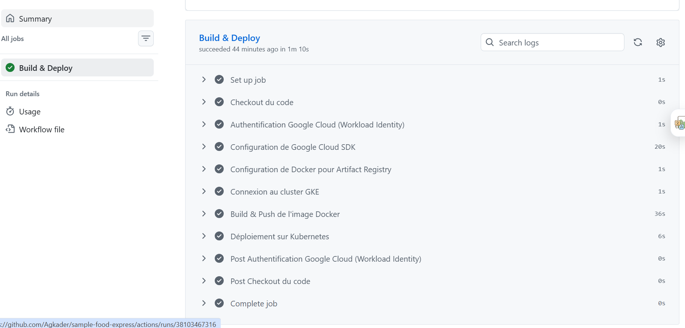

```markdown
# FoodExpress API - Cloud Native & Microservices

API RESTful de gestion de commandes pour un service de livraison de repas.
Développée initialement avec Node.js, Express et MongoDB, l'infrastructure a été entièrement repensée pour adopter une approche **DevOps & Cloud Native** de niveau production.

👤 **Auteur :** Abdoul Ganiyou Kader  
🎓 **Formation :** Master 1 - Ingénierie Logicielle, DevOps et IA (Supinfo Lille)

---

## 🏗️ Nouvelle Architecture Cloud & DevOps

Le projet a évolué d'un simple déploiement Serverless vers un véritable cluster Kubernetes managé, avec un pipeline d'intégration et de déploiement continu automatisé.

- **Infrastructure as Code (IaC) :** Provisionnement complet de l'infrastructure Google Cloud (GKE Autopilot, Artifact Registry, IAM) avec **Terraform**.
- **CI/CD :** Pipeline **GitHub Actions** pour le build de l'image Docker, le push sur Artifact Registry et le déploiement des manifestes Kubernetes.



- **Sécurité (DevSecOps) :** Authentification du pipeline CI/CD via **Google Workload Identity Federation** (Keyless, sans clés de service statiques).
- **Orchestration :** Hébergement haute disponibilité sur **Google Kubernetes Engine (GKE)**.
- **Observabilité :** Monitoring du cluster et des pods applicatifs avec **Prometheus** et **Grafana** (déployés via Helm).

---

## 🛠️ Stack Technique Complète

**Backend & Data**
- Node.js (v18), Express.js
- MongoDB Atlas (NoSQL)
- JWT (JSON Web Token), bcrypt, Joi
- Swagger (OpenAPI 3.0) pour la documentation interactive

**DevOps & Cloud (GCP)**
- Docker (Image optimisée `node:18-slim`)
- Kubernetes (GKE Autopilot)
- Terraform
- GitHub Actions
- Helm, Prometheus, Grafana

---

## 🚀 Lancer le projet en local

### Prérequis
- Node.js et npm installés
- Docker installé
- Un cluster MongoDB Atlas

### Variables d'environnement
Créer un fichier `.env` à la racine du dossier applicatif :
```env
DB_CONNECT=url_mongodb_atlas
TOKEN_SECRET=clé_jwt

```

### Démarrage classique (Node.js)

```bash
cd app
npm install
npm start

```

### Démarrage conteneurisé (Docker)

```bash
docker build -t food-express-api .
docker run -p 3000:3000 --env-file .env food-express-api

```

---

## ☁️ Déploiement sur Kubernetes (GKE)

L'infrastructure est gérée via Terraform dans le dossier `/terraform` et les ressources Kubernetes dans `/k8s`.

**1. Déployer l'infrastructure :**

```bash
cd terraform
terraform init
terraform apply -auto-approve

```

**2. Déploiement applicatif :**
Le déploiement de l'API est géré automatiquement par GitHub Actions lors d'un *push* sur la branche `main`.

**3. Accéder au Monitoring (Grafana) :**

```bash
helm repo add prometheus-community [https://prometheus-community.github.io/helm-charts](https://prometheus-community.github.io/helm-charts)
helm install monitoring prometheus-community/kube-prometheus-stack --namespace monitoring --create-namespace
kubectl port-forward svc/monitoring-grafana 8080:80 -n monitoring

```

Accès sur `http://localhost:8080` (Identifiants récupérables via les secrets Kubernetes).

---

## 🧪 Tests

Tests unitaires et d'intégration réalisés avec Jest et Supertest.

```bash
npm test

```

---

## 👥 Comptes de test

| Rôle | Email | Mot de passe |
| --- | --- | --- |
| **Admin** | `admin@foodexpress.com` | `Admin123!` |
| **User** | `user@test.com` | `Password123!` |

---

## Fonctionnalités principales

* Documentation dynamique des routes via Swagger
* Inscription / Connexion sécurisée
* Gestion du profil utilisateur
* Gestion des restaurants et menus (CRUD réservé aux admins)
* Consultation publique avec filtres et pagination
* Routes protégées et validation des données d'entrée

```